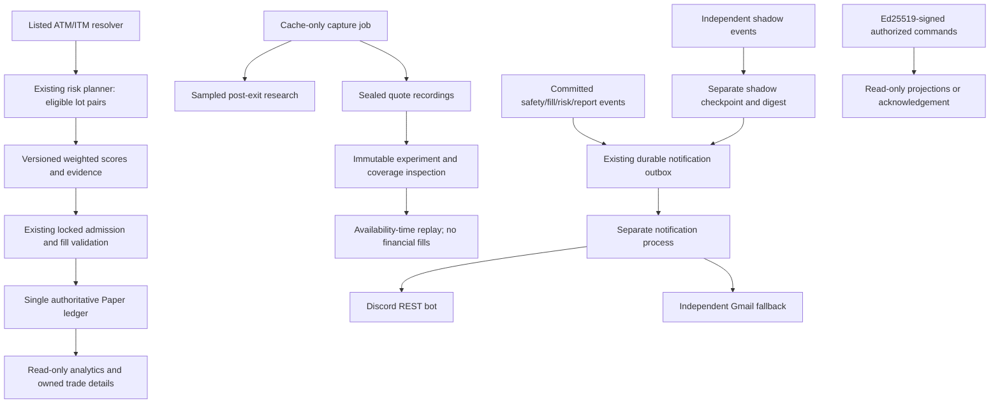

# Advanced Features Architecture

The canonical full strategy diagram remains in [ARCHITECTURE.md](ARCHITECTURE.md).
This document describes only extension boundaries.

The selector proposes; it does not submit orders. The existing executor retains
broker/position ownership. Analytics consumes immutable fills. Replay has no
order or configuration-mutation API. Discord cannot invoke trading controls.
Critical incident generation remains inside durable application state.

## Additive schema

Existing tables are reused for incidents, events, recording scopes, observations,
definitions and the outbox. New notification tables hold encrypted bot settings,
attempt receipts, reminder checkpoints, idempotent acknowledgements and an
independent shadow notification cursor. Research adds exit-study aggregates and
immutable inspection results. There is no new account, position or P&L table.

`NiftyStore.initialize()` uses existing `Base.metadata.create_all()` and the
existing engine factory/NullPool. No existing columns are altered. Owner writes
take the existing transaction lock; settings also require the current revision.
Shadow projection does not write primary strategy events. Negative outbox event
IDs namespace shadow digests separately from positive primary event IDs.

Back up the configured database, report archive and encryption environment
before deployment. Initializing twice must retain balances, fills, reservations
and lockouts. Rollback retains additive tables and existing PAUSED/KILLED state;
never drop evidence or clear safety state to run an older binary.

## Isolation and limits

Protection retains its own scheduler job. Native recording is cache-only with
bounded per-cycle work. Discord/SMTP runs in a separate supervised process,
not an application scheduler executor. HTTP calls have explicit deadlines.
DB settings/user sessions close before SMTP. Notification projection is bounded
and stops advancing its checkpoint under backlog pressure.

Full Live transport, full-fidelity options replay, automated retention and
remaining production-worker/latency evidence are acceptance gaps documented in
[ADVANCED_FEATURES_READINESS.md](ADVANCED_FEATURES_READINESS.md).
