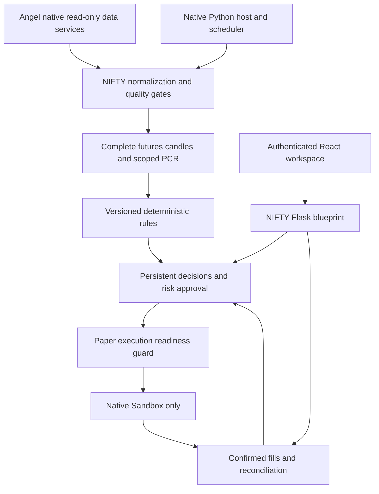

# NIFTY ALGO architecture

The existing Flask process serves the NIFTY browser blueprint. OpenAlgo’s signed session and CSRF middleware protect feature mutations. Feature tables share the configured main SQLAlchemy database, with NullPool for SQLite and context-managed transactions. Creating tables is additive and idempotent.

The diagram describes the target integration. Implementation status and unresolved edges are tracked per phase. Readiness must identify unimplemented execution prerequisites explicitly.

Use native Socket.IO and event subscriptions for completed decisions and fills. Every subscription needs teardown. Use bounded data windows and paginated database queries. No per-request threads, schedulers, HTTP pools or broker connections belong in the NIFTY module.

The Python host copies one strategy script into its managed scripts directory. The eventual runner must use the host interpreter, injected key and URL, cooperative SIGTERM handling and the existing holiday/session scheduler. Import paths and request authentication need validation under the actual host before registration is reported complete.
