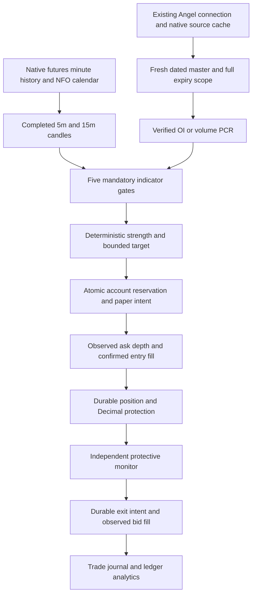

# NIFTY ALGO architecture

The authenticated Flask blueprint and existing `/nifty-algo` React workspace
share OpenAlgo's application, database engine, signed sessions and CSRF rules.
NIFTY uses its own feature ledger, not the shared Sandbox or Analyzer routing.

`services/nifty_algo/runner.py` reuses the native Python strategy host's existing
IST APScheduler. It does not upload a generic SDK trading script: that template
routes orders according to Analyzer mode and conflicts with this feature's
PAPER_ONLY boundary. Explicit monitor attachment creates three identifiable jobs
per user: protection every second, entry work every five seconds and report
generation plus bounded email delivery every minute. Feed/authentication checks run every five seconds; entry
history is requested once per completed five-minute boundary. Protection does
not wait for history downloads, and neither protection nor entries waits on
SMTP. The native scheduler owns job execution; this
feature creates no scheduler, broker session, private thread or polling loop.

A durable 30-second owner lease fences competing application instances. Jobs
coalesce missed runs and permit one invocation per job. Entry configuration and
startup/reconnect/rollover time establish a causal floor; missed old signals
are not entered on restart. Source subscriptions are acknowledged and reused;
pre-existing subscriptions are borrowed. Added obsolete subscriptions are
released on rollover. Cache callbacks are removed on replacement/shutdown.

The source cache preserves exchange timestamps and receipt times separately
from display defaults. Angel's optional raw OI/volume fields remain missing
when absent. Native master status must be dated today and match the connected
broker. PCR uses every valid CE/PE in the selected dated master expiry, with
paired strikes, no duplicate identities, no missing values, and bounded source
age/skew. A malformed current master cannot silently reduce the universe.

`nifty_algo_protection`, `nifty_algo_runner`, and `nifty_algo_depth_use` are
additive tables. Existing ledger tables and configuration history are retained.
All account-sensitive writers take a database write/row lock before reading
mutable state. Pending BUY intents reserve the single permitted position;
competing intents cannot independently pass account checks. Final fills repeat
risk, state, tick, source-time, displayed-size and fee validation atomically.
A consumed displayed snapshot cannot supply the same side's quantity twice.

Entry orders and protection retain configuration, confidence, signal context,
trigger levels and observations. Exit orders retain final protection. Trade
views join those immutable contexts to fees and gross/net results. Socket.IO
updates use `emit_from_any_thread` and signed-session user rooms on the main
application socket. The workspace subscribes, rejoins after reconnect and
unsubscribes on unmount. HTTP polling remains a fallback.

Input decisions remain immutable pre-admission assessments. Atomic admitted intents carry the actual risk approval and emit a durable `paper_intent_admitted` event. Recovery validates fill/quantity/cash invariants using bounded results and SQL aggregates. Journal performance aggregates all trades, while the display query remains paginated to recent records.

### Protection and profit booking

`services/nifty_algo/protection.py` is the NIFTY paper system's intentionally
isolated, pure Decimal evaluator. It models the exit fill after configured
slippage and fees, then finds the lowest tick-aligned stop whose modeled net
meets the configured floor. Consumers supply the cost function and translate
the returned state; database, runner and frontend code do not re-derive these
formulas. Shared consumers remain governed by `services/risk/`, and NIFTY
formulas must not be copied into another evaluator.

The initial premium stop and target remain unchanged. A separate 1.5-point
trailing stop follows the best observed bid and continues after profit lock
activation. At modeled net profit of at least ₹400, the evaluator activates a
tick-aligned floor targeting at least ₹350 net. The effective stop is the
maximum of the initial, persisted, trailing and floor stops and cannot move
down. If the market gaps through the floor, the paper ledger records the actual
simulated fill and realized net, emits `PROFIT_FLOOR_GAP`, and does not label a
below-floor trade as locked.

Early booking is discretionary: it requires at least ₹300 modeled net, a
30-percent retrace of the premium run-up, and weakening direction-adjusted
MACD momentum and close movement on consecutive completed decision bars. It is
disabled once the profit lock is active. Mandatory stop, target, time, session,
technical and operator exits take precedence. Live stop modification is not
implemented; any future live path is gated to Phase 5 and must reconcile broker
acknowledgements before updating protection state.

### Trading modes and the Live boundary

`services/nifty_algo/trading_mode.py` decides every mode change once under the
per-user database lock: compare-and-set on the mode revision, exposure read in
the same transaction, then the update. `nifty_algo_mode` keeps the mode, its
revision and a capped change history; every change and refusal is an audit
event. Broker status shown to the workspace is masked — booleans, the broker
id and the key source only, never a secret character or length.

Live is blocked by construction, not by a flag. `LiveAdapterStub` has no
transport and imports no broker module; `reachable()` returns `False`,
`readiness()` always reports `LIVE_NOT_READY` plus `MARKET_DATA_UNVERIFIED`,
`PROTECTIVE_ORDERS_UNVERIFIED`, `FILL_RECONCILIATION_UNVERIFIED` and
`STATIC_IP_UNVERIFIED`, and `submit()` raises `OrderRefused([LIVE_NOT_READY])`.
`live_readiness()` appends `LIVE_NOT_READY` unconditionally even if every other
check passed. Unblocking Live requires a real adapter and independent
verification of broker auth, market-data quality, protective-order acceptance,
fill reconciliation and deployment prerequisites — a code change, never a
setting. The paper executor also refuses BUY intents when the stored mode is
not PAPER, re-checked at admission and at fill under the user lock; exits of
existing paper positions stay simulated in any mode so protection never stops.
