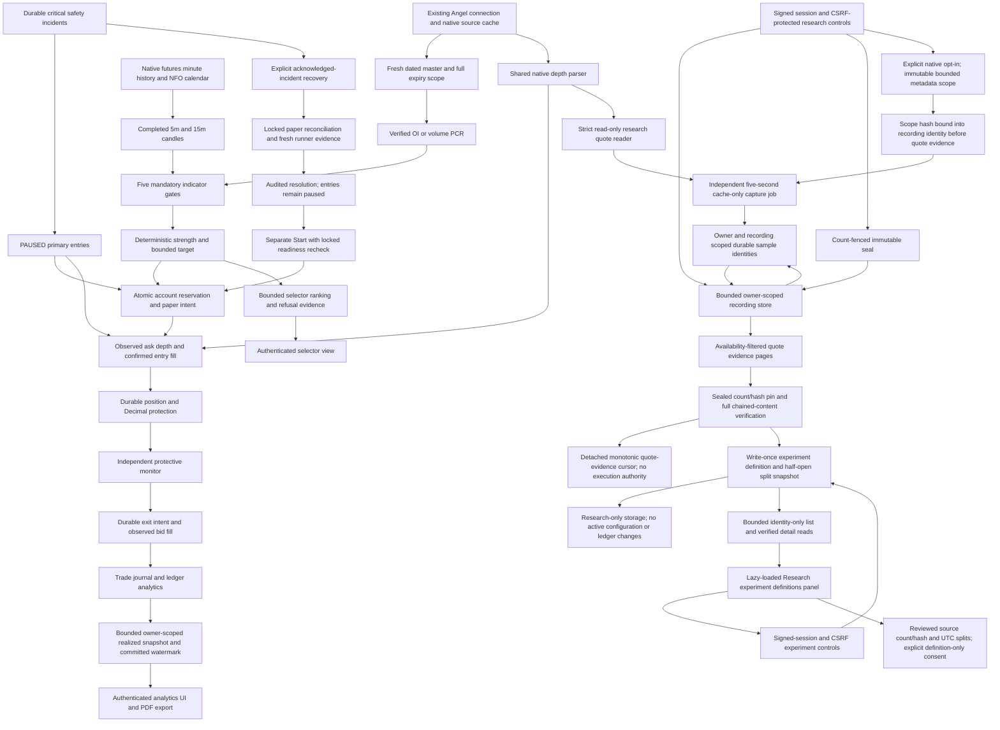

# NIFTY ALGO architecture

The authenticated Flask blueprint and existing `/nifty-algo` React workspace
share OpenAlgo's application, database engine, signed sessions and CSRF rules.
NIFTY uses its own feature ledger, not the shared Sandbox or Analyzer routing.

The resolver preserves approved ATM/ITM candidate and expiry boundaries. The
`risk-approved-weighted-v1` planner compares eligible contract/quantity pairs
using configured weights and existing sizing limits. Default weights preserve
legacy configuration identities; changed weights receive a new identity.
Admission and fill validate selected identity and current spot under the existing
ledger lock. Durable refusal evidence has no execution authority.

The latest extension boundaries, additive schema and notification-process flow
are in [ADVANCED_FEATURES_ARCHITECTURE.md](ADVANCED_FEATURES_ARCHITECTURE.md).
Discord consumes committed primary events and independently checkpointed shadow
events; shadow execution never writes primary strategy events for notification.
Owned trade inspection reads reconciled fills and sampled excursion evidence.
The independent capture job samples post-exit bids through effective session
close. Replay reads sealed evidence and refuses financial outcomes when inputs
are incomplete. Remaining acceptance is explicit in
[ADVANCED_FEATURES_READINESS.md](ADVANCED_FEATURES_READINESS.md).

Safety incidents and versioned operator actions share the existing feature
database. Resolution evidence lives in committed `safety_resolved` events and
is hydrated by a bounded owner-scoped status query. Acknowledgement and
resolution cannot resume trading. Neither the Safety Center nor its UI bypasses
the entry or fill locks, and incident holds never disable the protective monitor.
See [SAFETY_MODEL.md](SAFETY_MODEL.md) for the recovery contract.

Analytics reads use short-lived database session contexts, not the account
rollover or order-admission paths. A committed trade watermark fences later
fills; immutable fill evidence supplies full-period Decimal metrics independently
of the newest-first fill page. Periods are start-inclusive and end-exclusive,
limited to 366 days and 5,000 fills. The HTTP date inputs denote IST midnights;
the snapshot records their UTC instants. Partial exits count once per entry in
trade statistics and separately at each exit timestamp in realized curves.
Equity is seed plus realized net. Without a persisted mark series, marked
unrealized P&L and observed mark-to-market drawdown remain unavailable.

The workspace plots realized equity and realized drawdown as step curves,
groups results by IST session and downloads a freshly read snapshot as PDF.
PDF totals are independent of its explicitly paginated fill appendix. Exports
retain the selected period and watermark, require the signed session and send
`private, no-store`. PDF rendering introduces no scheduler, network client or
broker call; the database session closes before rendering.

Research quote evidence uses additive `nifty_algo_research_recording` and
`nifty_algo_research_observation` tables, never the paper account or order tables.
`research.recording_cursor()` loads only sealed owner-scoped evidence pinned by
count and content SHA-256. It verifies page sequence, normalized quote hashes,
the context/scope/content chain, byte count and source/availability chronology
before returning a detached cursor. Steps release at most 100 observations
whose availability time has arrived; the clock cannot move backward.
The cursor retains no store, connection, subscription or global registry.
Its complete manifest is audit metadata, not point-in-time strategy input.
Hashes do not authenticate provenance. This internal quote-evidence primitive
has no HTTP/UI integration and does not simulate fills, PCR,
decisions or P&L; `options_replay()` remains unavailable.
`nifty_algo_research_experiment` stores write-once definitions after full cursor
verification. Definitions freeze dataset, validated research configuration,
engine version, three half-open UTC splits and a canonical content hash.
Creation rechecks the source manifest under the existing owner transaction lock.
Bounds are 50 definitions per owner, 64 KiB per configuration and 1 MiB per
snapshot. Reads create no account or runner state. Status remains `DEFINED`,
performance is null and execution eligibility is false. Definitions do not
prove split coverage; experiment runs and results remain unwired.
Authenticated `/research/experiments` controls create definitions from owned
sealed evidence, pinned count/hash and bounded settings overrides merged into
the recording's frozen settings, never active settings. Mutations require CSRF
and `DEFINE_ONLY`; all control bodies are limited to 2 KiB. Lists project at
most 50 identities without loading snapshots; detail reads verify integrity.
Responses are private/no-store. There are no edit, deletion or execution routes.
The Research workspace lazy-loads an experiment definitions panel next to
recording controls. Operators review a sealed source and its pinned count/hash,
enter UTC split boundaries and optionally override ADX minimum or ATR period
for that immutable definition. Blank fields retain the recording configuration.
Explicit consent is required. The shared query cache deduplicates recording
reads; changed or unavailable source evidence disables creation. Unverified
persisted detail is hidden after a failed refresh. Mutations never retry
automatically; an uncertain write blocks creation until a successful explicit
refresh lets the operator inspect saved definitions before trying again.
An explicit recording freezes its configuration and UTC window. Appends validate
source, receipt and availability times, serialize Decimal quotes as strings,
reject duplicate evidence and advance a content hash chain under the existing
owner transaction lock. An expected observation count fences competing writers.
Sealing prevents further appends; it does not certify data completeness or
execution suitability. Reads are owner-scoped, bounded to 100 rows and fenced
at the manifest's committed sequence. Optional as-of filtering uses availability,
not source time, so delayed evidence is not exposed early. Authenticated HTTP
controls create empty bounded recordings, list owned manifests, page evidence
and seal at an expected count. Mutations require CSRF and strict control JSON
limited to 2 KiB, including unknown-length streams. They accept no market
observations or caller-selected provenance and cannot alter trading settings.
Responses use `private, no-store`. An optional strict JSON boolean
`native_capture` defaults to false. True requests cache-only capture; creation
never initializes a cache, connects a feed or attaches a monitor. The list's
`capture_status=NATIVE_CAPTURE_REQUESTED` means at least one owned manifest
has opted in, not that a feed is connected or evidence is complete. Without
such a manifest it retains `NOT_CONNECTED`. The Research recording panel exposes
bounded creation, explicit native-capture opt-in and count-fenced sealing; it
does not connect a feed or represent request presence as capture health.
The native research reader accepts only identified mode-3 source observations
from an already supplied cache. It shares the paper depth parser, with stricter
research admission: both usable sides, at most 20 levels per side, and no
malformed levels or fractional/boolean quantities. It retains native OI and
packet sequence when supplied. It cannot establish broker-authenticated
provenance and does not initialize a cache, subscribe or reconnect.

Internal bounded appends can opt into durable sample deduplication using the
additive `nifty_algo_research_sample` table. The normalized quote identity excludes
the sampling envelope's availability time, so polling the same cache snapshot
does not create new evidence or replace its first availability. Identities and
observations commit together under the existing owner lock; failed writes roll
both back. Identity count cannot exceed the recording's observation quota.
This internal option does not add an HTTP evidence-import path.

An additive `nifty_algo_research_capture` sidecar distinguishes explicit native
opt-in from existing recordings. The creation flag defaults to false.
Before observations, the current runner
can freeze 1 to 1,000 unique, tradable NIFTY option identities from today's
master, bounded to 512 KiB. The canonical scope stores broker, metadata and
freeze time; its hash advances the recording identity under the owner lock.
Neither broker labels nor hashes authenticate the feed. Subsequent scope
changes conflict, and restarts preserve the original snapshot.

Native opt-in appends require a frozen scope and current runner ownership.
Only `NATIVE_FEED` observations for frozen tokens with source times at or after
the freeze can append. Existing recordings cannot be silently adopted. The
sidecar is returned in owner-scoped manifests. A separate five-second job samples
only the already connected, authenticated and acknowledged native cache. The
scope must agree across feed setup's two master reads. Capture rejects changed
master, socket, subscriptions or reconnect generation before appending. Writes
recheck the current runner owner under the database lock without renewing its
lease or entry readiness. Capture neither subscribes nor reconnects.

Each tick samples at most 100 instruments with a 250 ms loop budget and bounded
wall-clock rotation, without retaining an in-memory history or cursor. The loop
budget is not a timeout on database operations. Samples must follow both scope
freeze and runner startup. Durable deduplication suppresses repeated snapshots;
full, expired, sealed and legacy recordings are skipped. The job selects the
newest eligible recording per tick; overlapping recordings have no complete
coverage guarantee. Quote evidence cannot authorize execution.

Quote-only evidence cannot establish point-in-time instrument identity, PCR,
the full listed candidate universe, queue priority or executable fills.

`services/nifty_algo/runner.py` reuses the native Python strategy host's existing
IST APScheduler. It does not upload a generic SDK trading script: that template
routes orders according to Analyzer mode and conflicts with this feature's
PAPER_ONLY boundary. Explicit monitor attachment creates four identifiable jobs
per user: protection every second, entry work every five seconds and report
generation plus bounded email delivery every minute, and research capture every
five seconds. Registration failure removes previously added jobs; shutdown
removes capture along with the other jobs. Each callback runs in its own
application context. Feed/authentication checks run every five seconds; entry
history is requested once per completed five-minute boundary. Protection does
not wait for history downloads, and neither protection nor entries waits on
SMTP. The native scheduler owns job execution; this
feature creates no scheduler, broker session, private thread or polling loop.

A durable 30-second owner lease fences competing application instances. Jobs
coalesce missed runs and permit one invocation per job. Entry configuration and
startup/reconnect/rollover time establish a causal floor; missed old signals
are not entered on restart. Source subscriptions are acknowledged and reused;
pre-existing subscriptions are borrowed. Added obsolete subscriptions are
released on rollover. Cache callbacks are removed on replacement/shutdown.

The source cache preserves exchange timestamps and receipt times separately
from display defaults. Angel's optional raw OI/volume fields remain missing
when absent. Native master status must be dated today and match the connected
broker. PCR uses every valid CE/PE in the selected dated master expiry, with
paired strikes, no duplicate identities, no missing values, and bounded source
age/skew. A malformed current master cannot silently reduce the universe.

`nifty_algo_protection`, `nifty_algo_runner`, and `nifty_algo_depth_use` are
additive tables. Existing ledger tables and configuration history are retained.
All account-sensitive writers take a database write/row lock before reading
mutable state. Pending BUY intents reserve the single permitted position;
competing intents cannot independently pass account checks. Final fills repeat
risk, state, tick, source-time, displayed-size and fee validation atomically.
A consumed displayed snapshot cannot supply the same side's quantity twice.

Entry orders and protection retain configuration, confidence, signal context,
trigger levels and observations. Exit orders retain final protection. Trade
views join those immutable contexts to fees and gross/net results. Socket.IO
updates use `emit_from_any_thread` and signed-session user rooms on the main
application socket. The workspace subscribes, rejoins after reconnect and
unsubscribes on unmount. HTTP polling remains a fallback.

Input decisions remain immutable pre-admission assessments. Atomic admitted intents carry the actual risk approval and emit a durable `paper_intent_admitted` event. Recovery validates fill/quantity/cash invariants using bounded results and SQL aggregates. Journal performance aggregates all trades, while the display query remains paginated to recent records.

### Protection and profit booking

`services/nifty_algo/protection.py` is the NIFTY paper system's intentionally
isolated, pure Decimal evaluator. It models the exit fill after configured
slippage and fees, then finds the lowest tick-aligned stop whose modeled net
meets the configured floor. Consumers supply the cost function and translate
the returned state; database, runner and frontend code do not re-derive these
formulas. Shared consumers remain governed by `services/risk/`, and NIFTY
formulas must not be copied into another evaluator.

The initial premium stop and target remain unchanged. A separate 1.5-point
trailing stop follows the best observed bid and continues after profit lock
activation. At modeled net profit of at least ₹400, the evaluator activates a
tick-aligned floor targeting at least ₹350 net. The effective stop is the
maximum of the initial, persisted, trailing and floor stops and cannot move
down. If the market gaps through the floor, the paper ledger records the actual
simulated fill and realized net, emits `PROFIT_FLOOR_GAP`, and does not label a
below-floor trade as locked.

Early booking is discretionary: it requires at least ₹300 modeled net, a
30-percent retrace of the premium run-up, and weakening direction-adjusted
MACD momentum and close movement on consecutive completed decision bars. It is
disabled once the profit lock is active. Mandatory stop, target, time, session,
technical and operator exits take precedence. Live stop modification is not
implemented; any future live path is gated to Phase 5 and must reconcile broker
acknowledgements before updating protection state.

### Trading modes and the Live boundary

`services/nifty_algo/trading_mode.py` decides every mode change once under the
per-user database lock: compare-and-set on the mode revision, exposure read in
the same transaction, then the update. `nifty_algo_mode` keeps the mode, its
revision and a capped change history; every change and refusal is an audit
event. Broker status shown to the workspace is masked — booleans, the broker
id and the key source only, never a secret character or length.

Live is blocked by construction, not by a flag. `LiveAdapterStub` has no
transport and imports no broker module; `reachable()` returns `False`,
`readiness()` always reports `LIVE_NOT_READY` plus `MARKET_DATA_UNVERIFIED`,
`PROTECTIVE_ORDERS_UNVERIFIED`, `FILL_RECONCILIATION_UNVERIFIED` and
`STATIC_IP_UNVERIFIED`, and `submit()` raises `OrderRefused([LIVE_NOT_READY])`.
`live_readiness()` appends `LIVE_NOT_READY` unconditionally even if every other
check passed. Unblocking Live requires a real adapter and independent
verification of broker auth, market-data quality, protective-order acceptance,
fill reconciliation and deployment prerequisites — a code change, never a
setting. The paper executor also refuses BUY intents when the stored mode is
not PAPER, re-checked at admission and at fill under the user lock; exits of
existing paper positions stay simulated in any mode so protection never stops.
